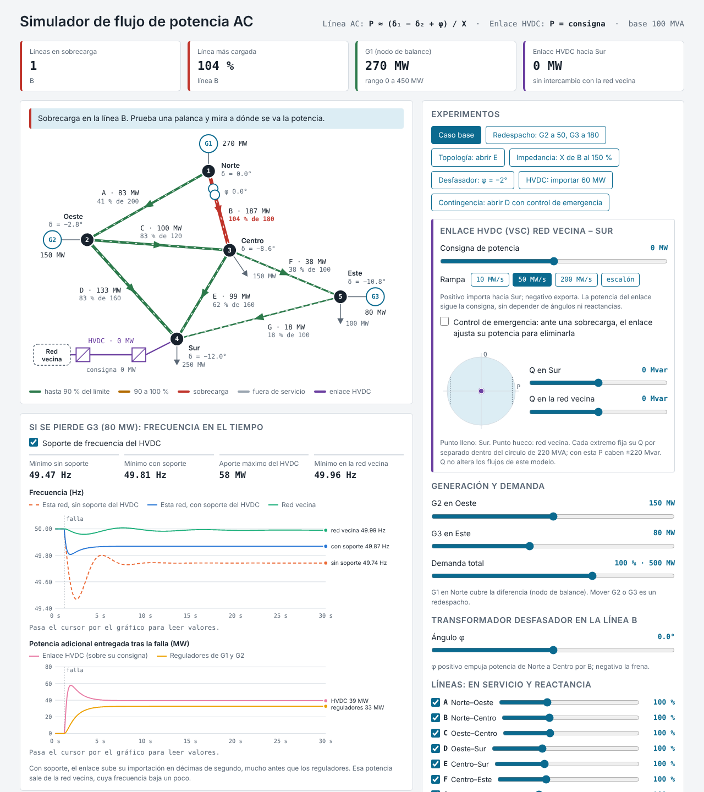

# Simulador de flujo de potencia AC

Simulador interactivo para ver cómo se reparte la potencia activa en una red de corriente alterna mallada, y cómo cambia ese reparto al actuar sobre la generación, la topología, la impedancia de las líneas o un transformador desfasador. Incluye un enlace HVDC para ver el contraste: ahí la potencia es una consigna.

**[Abrir el simulador](https://ajrcjf-web.github.io/ac-power-flow-simulator/)** · **[Leer la guía de conceptos (PDF)](https://ajrcjf-web.github.io/ac-power-flow-simulator/docs/flujo_potencia_AC_conceptos.pdf)**



## Objetivo

En una línea AC la potencia activa depende de las tensiones en los extremos, la reactancia y el ángulo entre ambos nodos:

```
P ≈ V1 · V2 · sen δ / X
```

Nadie ajusta ese flujo directamente: se reparte por la red según las impedancias. Para cambiarlo hay que actuar de forma indirecta. En un enlace HVDC ocurre lo contrario: el operador fija cuántos MW, en qué dirección y con qué rampa, y el convertidor lo cumple. Este proyecto busca que esa idea se entienda viéndola, sin necesidad de experiencia previa en herramientas de simulación de sistemas de potencia.

Está pensado para ingenieros, responsables de proyecto y managers con formación eléctrica que quieran una intuición rápida de por qué aliviar una línea casi siempre carga otra.

## Qué incluye

| Archivo | Contenido |
|---|---|
| `index.html` | El simulador completo en un solo archivo. No requiere instalación ni servidor. |
| `docs/flujo_potencia_AC_conceptos.pdf` | Guía de 9 páginas con los conceptos, las cuatro palancas, una sección dedicada al HVDC y ejemplos numéricos tomados del simulador. |

## Funcionamiento básico

La red tiene 5 nodos y 7 líneas. La generación principal está en Norte y la demanda principal en Sur. En el caso base la línea B queda al 104 % de su límite: ese es el problema por resolver. El nodo Sur está unido a una red vecina asíncrona mediante un enlace HVDC (VSC) de 200 MW.

Palancas sobre la red AC:

| Palanca | Control en el simulador | Qué representa |
|---|---|---|
| Redespacho | Deslizadores de G2 y G3 (G1 cubre la diferencia) | Cambiar dónde se genera |
| Topología | Casilla de cada línea | Abrir o cerrar interruptores |
| Impedancia | Deslizador de reactancia por línea, 50 a 200 % | Compensación serie o reactor serie |
| Desfasador | Ángulo φ de −15° a +15° en la línea B | Transformador desfasador (PST) |

El diagrama muestra sentido, MW y porcentaje de carga de cada línea. La tabla inferior compara cada flujo con una referencia que se puede fijar en cualquier momento, para ver el efecto incremental de cada acción. Hay siete botones de experimento que cargan cada caso de un clic.

### Enlace HVDC

| Qué se demuestra | Control en el simulador |
|---|---|
| Magnitud, dirección y rampa por consigna | Deslizador de −200 a +200 MW y selector de rampa (10, 50, 200 MW/s o escalón) |
| P y Q independientes, dentro de límites | Q de cada extremo y diagrama P-Q de 220 MVA, que recorta Q cuando P es alta |
| Control de emergencia (run-up, runback) | Casilla que deja al enlace ajustar su potencia para eliminar una sobrecarga |
| Soporte de frecuencia y efecto cortafuegos | Gráfico de frecuencia tras perder G3, con y sin soporte, incluida la red vecina |
| El HVDC traslada potencia, no la genera | G1 baja lo que el enlace importa, y la frecuencia de la red vecina cae cuando presta soporte |

### Modelo

Flujo de cargas linealizado (flujo DC) sobre base 100 MVA. Por cada línea:

```
P ≈ (δ1 − δ2 + φ) / X      [pu]
```

Se resuelve el sistema lineal B·δ = P con el nodo Norte como referencia (δ = 0) y nodo de balance. El enlace HVDC entra como una inyección fija en Sur, igual a su consigna.

La respuesta de frecuencia usa una masa equivalente por red, un regulador primario de primer orden y carga dependiente de la frecuencia. El soporte del HVDC es proporcional a la desviación de frecuencia, con una constante de tiempo de 50 ms y limitado por el margen hasta su potencia nominal.

## Consideraciones y límites

- **Es una herramienta didáctica, no de estudio.** Los datos de la red son ilustrativos y están elegidos para que los efectos se vean con claridad. No representan una red real.
- **Aproximación DC.** Sin pérdidas, tensiones en 1 pu y ángulos pequeños (sen δ ≈ δ). Es adecuada para el reparto de potencia activa; no calcula potencia reactiva, perfil de tensiones ni pérdidas.
- **Solo evalúa el límite térmico.** No hay análisis de estabilidad ni de tensión, ni comprobación N-1 automática.
- **La Q del convertidor no altera los flujos.** Solo se contrasta con el diagrama P-Q, porque el modelo no calcula tensiones.
- **Dinámica simplificada.** La respuesta de frecuencia ilustra órdenes de magnitud; no incluye oscilaciones electromecánicas ni su amortiguamiento, ni la dinámica interna de los convertidores.
- **Islas.** Si una maniobra aísla un nodo del nodo de balance, el modelo lo considera desenergizado.

Para estudios reales se usan herramientas de flujo de cargas AC completo con datos validados de la red.

## Uso local

Descarga `index.html` y ábrelo en cualquier navegador moderno. Necesita conexión solo para cargar las tipografías; sin ella funciona igual con las del sistema.

## Créditos

Desarrollado con asistencia de Claude (Anthropic).

## Licencia

MIT. Ver [LICENSE](LICENSE).
